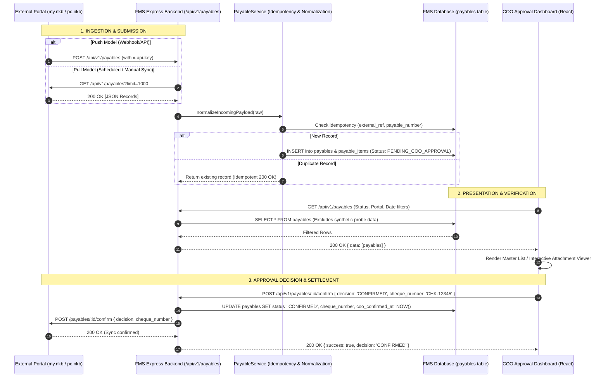

# 02 — PAYABLES BUSINESS PROCESS & WORKFLOW AUDIT

**System**: NKB Enterprise Formulation Management System (FMS)  
**Process Audited**: Cheque Disbursement & Accounts Payable Approval Lifecycle  
**Audit Standard**: End-to-End Implementation Verification  

---

## 1. Process Lifecycle Overview

The cheque disbursement approval lifecycle spans three primary stages:
1. **Origination & Ingestion**: Payable requests are prepared in external corporate portals or submitted via API/webhook into the FMS database queue.
2. **Review & Verification**: The COO or authorized reviewer inspects requisition numbers, payee/supplier details, invoice references, line items, and supporting PDF/image vouchers.
3. **Executive Decision & Cheque Issuance**: The reviewer records a physical cheque number, inputs executive remarks, and confirms approval (or rejection). The decision is committed locally and transmitted back to the originating portal.

---

## 2. Step-by-Step Business Process Analysis

### Step 1: Origination of Payable Requests [VERIFIED]
- **`my.nkbmanufacturing.com`**: Primary portal for commercial operating expenses, raw material purchase orders, fragrance concentrate deliveries, packaging components, and freight charges.
- **`pc.nkbmanufacturing.com`**: Petty cash disbursement portal used by branches and custodians for urgent or daily store operational expenses.
- **External Webhooks**: Third-party portals pushing payables via `POST /api/v1/payables` or `POST /api/v1/payables/webhook`.

### Step 2: Ingestion & Normalization [VERIFIED]
- **Entry Method A (HTTP Push / Webhook)**:
  - An external system issues `POST /api/v1/payables` with JSON payload and header `x-api-key`.
  - Authenticated via `authenticatePayablesAccess` (`server/routes/payables.js` line 242).
- **Entry Method B (HTTP Pull / Auto-Sync)**:
  - Executed during `GET /api/v1/payables` when `sync=true` is requested, when the database has $\le 2$ records, or when the 60-second background throttle has elapsed (`syncExternalPortalsSafe()`, `server/routes/payables.js` line 751).
  - Queries `https://pc.nkbmanufacturing.com/api/payables` and `https://my.nkbmanufacturing.com/api/v1/payables?limit=1000`.
- **Entry Method C (Direct MySQL Cross-Database Sync)**:
  - When hosted on production MySQL, `syncExternalPortalsSafe()` executes a direct read query on `u335953510_pc_db.payables` to ingest records directly (`server/routes/payables.js` lines 756-780).
- **Normalization Engine (`formatPayableItem` & `normalizeIncomingPayload`)**:
  - Located in `server/services/PayableService.js` lines 27-189, 422-570.
  - Automatically handles polymorphic field naming across systems (e.g. `payee_beneficiary` vs `supplier_name` vs `vendor` vs `company_name`; `requisition_no` vs `req_cheque_no` vs `payable_number`; `amount` vs `total` vs `amount_due`).
  - Dates: Parses ISO dates, US slash dates (`MM/DD/YYYY`), or natural month text (`October 1, 2026`) via `extractDateFromText()`.

### Step 3: Deduplication & Idempotency Storage [VERIFIED]
- Implemented in `PayableService.createPayable()` (`server/services/PayableService.js` lines 586-616).
- Checked against:
  1. `external_reference`
  2. `idempotency_key`
  3. `payable_number`
  4. `req_cheque_no`
- If an existing record is matched, the system returns `{ isDuplicate: true, record: ... }` with HTTP 200 without inserting a duplicate or resetting status.
- New records are inserted inside a database transaction (`trx`) into `payables` (header) and `payable_items` (line breakdown).

### Step 4: Status Determination on Ingestion [VERIFIED]
- Incoming status values are normalized (`server/services/PayableService.js` lines 618-636):
  - `'SUBMITTED FOR APPROVAL'`, `'PENDING APPROVAL'`, `'PENDING'` $\rightarrow$ **`PENDING_COO_APPROVAL`**
  - `'APPROVED'`, `'CONFIRMED'`, `'PAID'` $\rightarrow$ **`CONFIRMED`** (displayed as `Approved` in header status)
  - `'REJECTED'`, `'DISAPPROVED'` $\rightarrow$ **`REJECTED`**
- If a record is imported that was already approved in the source system, its approved state and existing cheque number are preserved.

### Step 5: Presentation & Queue Filtering [VERIFIED]
- In `src/pages/PayableApprovalsPage.jsx`:
  - **Master List View**: Displays all payables in a responsive table.
  - **Status Filter**: Pill tabs for `ALL`, `PENDING` (`PENDING_COO_APPROVAL`), `CONFIRMED` (`Approved`), and `REJECTED`.
  - **Portal Filter**: Dropdown allowing filtering by `ALL`, `my.nkbmanufacturing.com`, or `pc.nkbmanufacturing.com`.
  - **Date Filters**: Dual date range filter (`Date Cheque Issued` vs `Date Prepared`) with quick presets (`Today`, `Last 7 Days`, `This Month`).
  - **Search**: Multi-field client-side query matching requisition #, payee, cheque #, invoice #, bank, purpose, and vendor.
  - **Attachment Viewer**: Modal supporting inline viewing of PDF attachments and raster images (`resolveAttachmentUrl()` and `/api/v1/payables/attachment-proxy`).

### Step 6: Approval / Rejection Decision Flow [VERIFIED]
- Decisions can be made via:
  1. **Table Quick Action**: Clicking the checkmark or X icon directly in the table row (`handleExecuteQuickAction()`, line 433).
  2. **Voucher Detail View**: Navigating into the full voucher screen (`handleConfirmDecision()`, line 383).
- **Mandatory Validation Rule**:
  - If `decision === 'CONFIRMED'`, `cheque_number` is strictly required (`server/routes/payables.js` line 1041). The system blocks approval if no cheque number is provided.
- **Backend Execution**:
  - Invokes `POST /api/v1/payables/:id/confirm`.
  - Updates `payables.status = 'CONFIRMED'` (or `'REJECTED'`), `payables.coo_approval = 'CONFIRMED'`, `payables.cheque_number`, `payables.checked_by = approverName`, `payables.coo_confirmed_at = NOW()`.
  - Appends an audit timestamp note into `payables.comments`.
  - Emits an asynchronous outbound notification to the originating portal via `POST https://<portal>/api/v1/payables/:id/confirm`.
  - Logs action to FMS internal audit trail table (`audit_logs`) with action `PAYABLE_APPROVAL`.

### Step 7: Archiving, Cancellation & Deletion [VERIFIED]
- **Deletion**: Handled by `DELETE /api/v1/payables/:id` (`server/routes/payables.js` line 952). Deletes child items in `payable_items` then header in `payables`.
- **Archiving / Voiding**: [NOT IMPLEMENTED]. There is currently no `is_archived` or `voided` column in `payables`; records remain in `Approved` or `Rejected` status.
