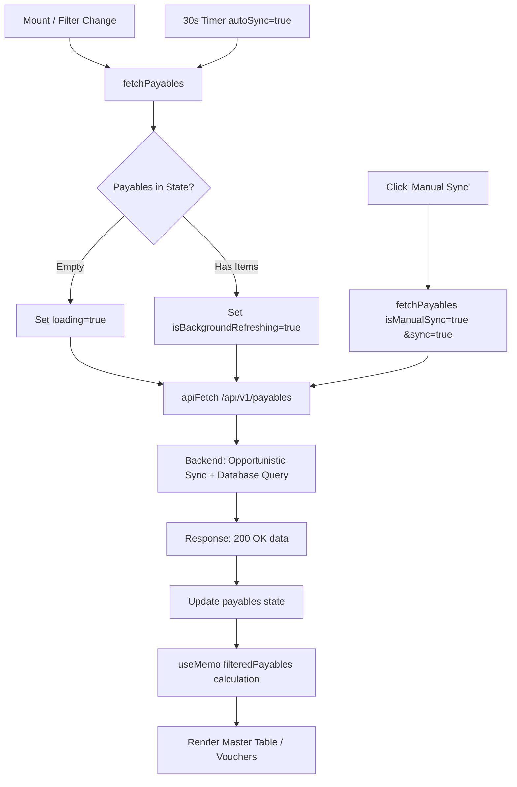

# 05 — FRONTEND-BACKEND DATA FLOW & UI LIFECYCLE AUDIT

**Component**: `src/pages/PayableApprovalsPage.jsx`  
**API Integration**: `src/services/api.js` (`apiFetch`)  
**Backend Routes**: `server/routes/payables.js`  
**Audit Standard**: State Flow & UI Rendering Lifecycle  

---

## 1. Component State & Architecture

The `PayableApprovalsPage` manages comprehensive reactive state for browsing, filtering, approving, and configuring payables:

---

## 2. Key State Variables & Roles

| State Variable | Type | Default | Lifecycle Role |
| :--- | :--- | :--- | :--- |
| `viewMode` | string | `'list'` | Controls main display: `'list'` (table queue) or `'detail'` (full voucher screen) |
| `payables` | Array | `[]` | Raw array of payable records fetched from backend |
| `selectedPayable` | Object | `null` | Active record opened in detail voucher view |
| `loading` | boolean | `true` | Full-screen initial loading skeleton spinner |
| `syncing` | boolean | `false` | Spinner indicator when manual portal sync button is clicked |
| `isBackgroundRefreshing` | boolean | `false` | Subtle indicator when polling or refreshing data without wiping the table |
| `searchTerm` | string | `''` | User search string across all columns |
| `statusFilter` | string | `'ALL'` | `'ALL'`, `'PENDING'`, `'CONFIRMED'`, `'REJECTED'` |
| `portalFilter` | string | `'ALL'` | `'ALL'`, `'my.nkbmanufacturing.com'`, `'pc.nkbmanufacturing.com'` |
| `autoSync` | boolean | `true` | When true, triggers 30-second background polling |
| `expandedRows` | Object | `{}` | Map of `{ [itemKey]: boolean }` tracking which table rows have child items expanded |
| `dateChequeFrom/To`| string | `''` | YYYY-MM-DD bounds filtering Date Cheque Issued |
| `datePreparedFrom/To`| string | `''` | YYYY-MM-DD bounds filtering Date Prepared |
| `quickActionItem` | Object | `null` | Item targeted for quick approval/rejection from table row |
| `quickActionType` | string | `null` | `'APPROVE'` or `'REJECT'` in quick modal |
| `previewAttachment`| Object | `null` | Active document opened in Interactive Attachment Viewer |
| `showConfigModal` | boolean | `false` | Modal for configuring portal API keys & URLs |
| `showApiKeysModal`| boolean | `false` | Modal for Developer Multi-API Key Management |

---

## 3. Data Fetching & Polling Flow

### Initial Load & Filter Updates [VERIFIED: lines 229-288]
1. When mounted or when any filter (`statusFilter`, `portalFilter`, date ranges) changes, `useEffect` invokes `fetchPayables()` and `fetchConfig()`.
2. To eliminate jarring screen flickers, `fetchPayables()` checks `payables.length`:
   - If `payables.length === 0`: Activates `loading = true` (initial loading state).
   - If `payables.length > 0`: Activates `isBackgroundRefreshing = true` (retains current table while updating in background).
3. The request executes `GET /api/v1/payables?search=...&status=...&portal=...&date_cheque_from=...`.
4. The backend checks if the database is in its initial state ($\le 2$ records) or if the 60-second background throttle has elapsed. If so, it synchronizes with the source portals before returning.
5. `setPayables(data.data)` updates state.

### 30-Second Automatic Polling [VERIFIED: lines 291-297]
- If `autoSync` is enabled (default `true`), a `setInterval` triggers `fetchPayables()` every 30,000 ms.
- If the user clicks the Auto-Sync toggle in the header, polling is disabled.

---

## 4. Client-Side Filtering & Calculations (`filteredPayables`)

[VERIFIED: lines 610-694] `filteredPayables` is a memoized selector (`useMemo`) that:
1. **Excludes Test Probes & Purged Samples**:
   - Strips out `id === 902`, `PC-2026-0412`, `CTRL-PC-2026-0044`.
   - Strips out synthetic test records starting with `PB-202610-` or containing `FMS SYNC TEST` / `TEST PROBE`.
2. **Filters by Source Portal**:
   - Matches against `p.source_portal`.
3. **Filters by Status**:
   - Maps `PENDING` $\rightarrow$ matches `PENDING_COO_APPROVAL`, `Submitted`.
   - Maps `CONFIRMED` $\rightarrow$ matches `CONFIRMED`, `Approved`, `Paid`.
   - Maps `REJECTED` $\rightarrow$ matches `REJECTED`, `Disapproved`.
4. **Filters by Dates**:
   - Checks `date_cheque_issued` (including dates extracted from text descriptions via `getChequeDateInfo()`).
   - Checks `date_prepared`.
5. **Full-Text Search Filter**:
   - Searches `req_cheque_no`, `payable_number`, `payee_beneficiary`, `company`, `category`, `bank_account`, `purpose_usage`, `cheque_number`, `invoice_number`, `vendor`.

---

## 5. UI Views & Interactive Features

### 5.1 Master Queue Table View (`viewMode === 'list'`)
- **Headers & Indicators**: Shows live connection status badges (`my.nkb` and `pc.nkb`), total count of matching entries, and total cumulative amount formatted in Philippine Pesos (`₱...`).
- **Expandable Nested Rows**: Clicking the chevron next to any payable toggles its itemized breakdown table, showing line items, quantities, costs, and individual dates.
- **Action Buttons per Row**:
  - `Detail` button: Opens full voucher view.
  - `Quick Approve` button (green checkmark): Opens quick approval modal pre-filled with the item's existing cheque number.
  - `Quick Reject` button (red X): Opens rejection confirmation modal.
  - `Attachment Clip`: Opens the interactive attachment viewer.

### 5.2 Full Voucher Detail View (`viewMode === 'detail'`)
- Displays an executive payment voucher with:
  - Header: Payable Number, Payee, Originating Portal badge, Status banner.
  - 4-Column Metadata Grid: Company, Category, Bank Account, Control Number, Invoice Number, Invoice Date, Due Date, Terms.
  - Itemized Items Table: Complete description, expense category, quantity, unit cost, subtotal, and total amount.
  - Tax Breakdown Grid: Subtotal, VAT (12%), Non-VAT, Withheld Tax, Amount Due.
  - Executive Action Box:
    - Cheque Number input (required for approval).
    - Executive Comments / Notes textarea.
    - `Confirm COO Approval` button (emerald).
    - `Reject Payable` button (red).
    - `Back to List` navigation.
    - `Print Payable Voucher` button (`window.print()`).

### 5.3 Interactive Attachment Viewer Modal
- Supports inline rendering of external invoice and voucher files:
  - PDFs: Embeds an inline iframe via `/api/v1/payables/attachment-proxy?url=...` with full pagination and zoom.
  - Images: Renders full-size preview with zoom/fit toggles.
  - Fallback: Offers a direct link to open the file in the external portal if proxying fails.
